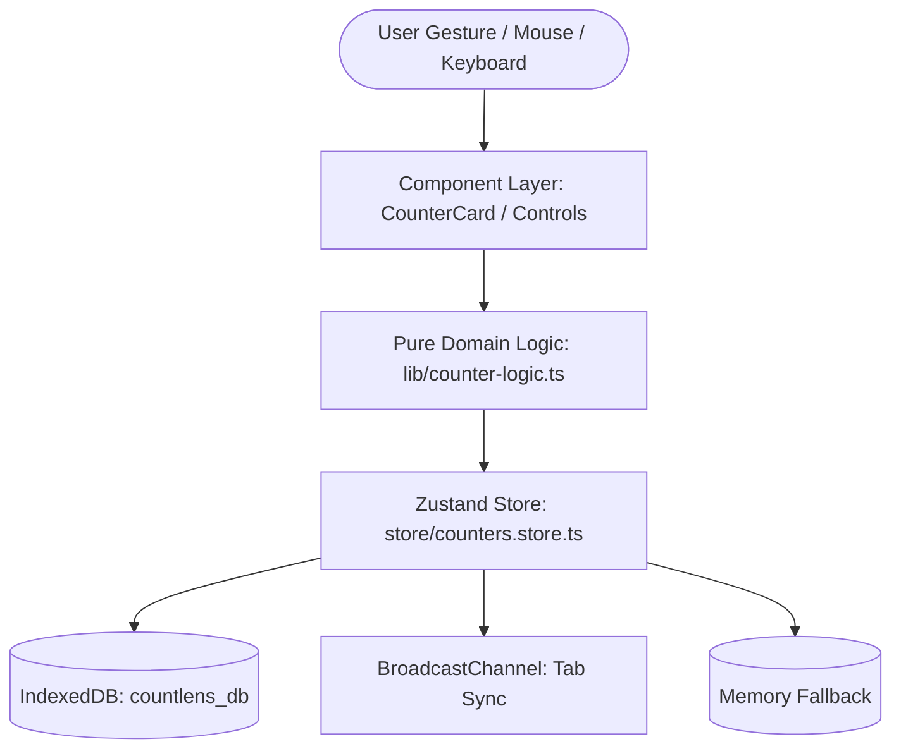

<div align="center">

# ⏱️ COUNTLENS

**A Tactile, 3D-Animated Digital Counter Studio**

Turn the humble act of counting into a responsive, physical-feeling digital experience.

[](https://nextjs.org/)
[](https://react.dev/)
[](https://www.typescriptlang.org/)
[](https://tailwindcss.com/)
[](https://threejs.org/)
[](https://developer.mozilla.org/en-US/docs/Web/API/IndexedDB_API)
[](https://vitest.dev/)

</div>

---

## 📖 Table of Contents
- [Vision & Design Principles](#-vision--design-principles)
- [Gestures & Tactile Mechanics](#-gestures--tactile-mechanics)
- [3D Depth & Motion Polish](#-3d-depth--motion-polish)
- [Architecture & Data Model](#-architecture--data-model)
- [Keyboard Shortcuts](#-keyboard-shortcuts)
- [Tech Stack](#-tech-stack)
- [Getting Started](#-getting-started)
- [Automated Testing & QA](#-automated-testing--qa)
- [Privacy & Local Persistence](#-privacy--local-persistence)

---

## 🎯 Vision & Design Principles

**COUNTLENS** elevates digital counting with physical tactile weight. Instead of flat, unresponsive buttons, users interact with counters using natural gestures (pulling with elastic resistance, scrubbing across ruler notches, flicking cards, and accelerating presses).

* **Tactile over flat**: Physical resistance curves, spring snaps, and haptic/audio micro-feedback.
* **Minimal over busy**: Crisp typography, layered dark/light glassmorphic surfaces, and restrained corner radii.
* **Fast over fancy**: Target 60fps animations; Three.js renders on-demand with lazy loading and reduced-motion fallbacks.
* **Accessible over clever**: Every single gesture has full keyboard and plain-button equivalents. `role="spinbutton"` ARIA attributes and polite live region announcements.

---

## 🖐️ Gestures & Tactile Mechanics

Every gesture is crafted with physical resistance and feedback:

| Gesture | Interaction Surface | Physics & Behavior | Non-Gesture Equivalent |
| :--- | :--- | :--- | :--- |
| **Pull-to-Count** | `PullHandle` (bottom ribbon) | Pull up to increment, pull down to decrement. Features logarithmic resistance ($F = d / (1 + \|d\|/200)$), live floating preview pill showing pending delta, and spring snap-back. | `+` and `-` buttons |
| **Drag Scrubber** | `DragScrubber` (center bar) | Horizontal scrub across ruler notches with haptic ticks and momentum commitment. | Step multiplier button |
| **Directional Swipe** | `SwipeSurface` (card body) | Swipe right to increment, left to decrement. Directional visual ripples show magnitude. | Arrow keys (`↑`/`↓`) |
| **Accelerating Hold** | `HoldButton` (`+` / `-` buttons) | Starts at 1 tick/300ms, ramping continuously down to 50ms (20 ticks/sec). Cancels immediately on release, blur, or hard limit. | Repeated clicks or typed entry |
| **Direct Numeral Edit** | `CounterValue` (large digits) | Click/tap the large tabular digits to edit the exact count directly with keyboard input. | `+` and `-` buttons |

> [!NOTE]
> Mobile touch events use strict `touch-action: pan-y` on card bodies and `touch-action: none` strictly on isolated gesture tracks. Standard page vertical scrolling is never blocked.

---

## 💎 3D Depth & Motion Polish

1. **Pointer-Driven 3D Tilt**:
   - Cards track cursor coordinates using perspective transformation (`perspective: 1000px`, dynamic spring-driven `rotateX`/`rotateY`).
   - A specular radial glow follows the cursor across the card surface.
2. **Direction-Aware Odometer Numerals**:
   - Digits roll upwards when incrementing and downwards when decrementing.
   - Fixed-width tabular digits prevent layout jitter.
3. **React Three Fiber Ambient Scene**:
   - Floating wireframe geometry (torus, octahedron, icosahedron) rendered with client-only Three.js.
   - DPR capped at 1.5 with WebGL error boundaries.
   - Automatically switches to an animated CSS gradient mesh if WebGL is unavailable or if `prefers-reduced-motion` is enabled.

---

## 🏗️ Architecture & Data Model

### Data Flow Diagram



### Counter Data Structure
```typescript
type Counter = {
  id: string;              // UUID
  name: string;            // 1–40 chars
  value: number;           // Current count
  initialValue: number;    // Reset target
  step: number;            // Step size (default 1, decimals supported)
  min: number | null;      // Optional lower bound
  max: number | null;      // Optional upper bound
  limitBehavior: "stop" | "wrap"; // Stop with shake vs wrap around
  color: string;           // Hex color from curated palette
  icon?: string;           // Lucide icon name
  pinned: boolean;         // Top shelf toggle
  order: number;           // Display order
  createdAt: number;       // Unix timestamp (ms)
  updatedAt: number;       // Unix timestamp (ms)
  history: CounterHistoryEntry[]; // Capped at last 100 events
};
```

---

## ⌨️ Keyboard Shortcuts

Global hotkeys operate throughout the entire application:

| Shortcut | Action |
| :--- | :--- |
| <kbd>N</kbd> | Open Create New Counter modal |
| <kbd>/</kbd> | Focus global search bar |
| <kbd>?</kbd> | Open keyboard shortcuts cheatsheet |
| <kbd>Esc</kbd> | Close dialog or unfocus search |
| <kbd>↑</kbd> / <kbd>↓</kbd> | Increment / Decrement active counter |
| <kbd>Shift</kbd> + <kbd>↑</kbd> / <kbd>↓</kbd> | Increment / Decrement active counter by 10× step size |
| <kbd>Cmd</kbd>/<kbd>Ctrl</kbd> + <kbd>Z</kbd> | Undo most recent counting action |

---

## 🛠️ Tech Stack

- **Framework**: Next.js 16.4.6 (App Router, Turbopack, Cache Components)
- **Runtime & UI**: React 19.3.0, TypeScript 5 (Strict Mode, `noUncheckedIndexedAccess`)
- **Styling & Tokens**: Tailwind CSS v4.3.3 with CSS-variable design tokens
- **Motion & Physics**: Motion 14.14 (Framer Motion)
- **3D Graphics**: Three.js 0.187, `@react-three/fiber` 9.8, `@react-three/drei` 10.7
- **UI Primitives**: Radix UI (Dialog, DropdownMenu, Popover, Switch, Slider, Tabs, AlertDialog, Slot)
- **State Management**: Zustand 5.1
- **Persistence**: `idb` 8.0 (IndexedDB)
- **Validation**: Zod 4.6
- **Icons**: Lucide React
- **Audio & Haptics**: Procedural Web Audio API & `navigator.vibrate`
- **Testing**: Vitest 5.1

---

## 🚀 Getting Started

### Prerequisites
- Node.js 18.18+ or 20+

### Installation
```bash
npm install
```

### Development Server
```bash
npm run dev
```
Open [http://localhost:3000](http://localhost:3000) in your browser.

### Production Build
```bash
npm run build
npm run start
```

---

## 🧪 Automated Testing & QA

Run the Vitest test suite:
```bash
npm test
```

### Coverage Includes:
- `clampValue` with upper, lower, and null limits.
- `wrapValue` across discrete integer cycles.
- Floating-point precision error elimination (`0.1 + 0.2 = 0.3`).
- Limit collision indicators (`stop` vs `wrap`).
- History stack cap (100 entries max) and delta inversion during undo.
- Record duplication and initial value resetting.

---

## 🔒 Privacy & Local Persistence

1. **Zero Cloud Dependencies**: 100% client-side. No trackers, no analytics, no external servers.
2. **Encrypted Local Storage**: Data is saved directly in browser IndexedDB.
3. **Cross-Tab Synchronization**: Updates in one tab immediately sync to others via `BroadcastChannel`.
4. **Backup & Restore**: Export all counters into human-readable JSON; restore backups with automatic Zod schema verification and merge/replace options.
5. **Private Mode Fallback**: If IndexedDB is blocked, COUNTLENS seamlessly falls back to an in-memory session store with a friendly warning banner.

---

<div align="center">
Made with precision for tactile counting.
</div>
